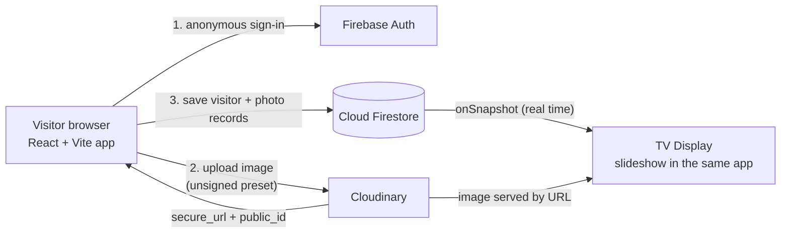
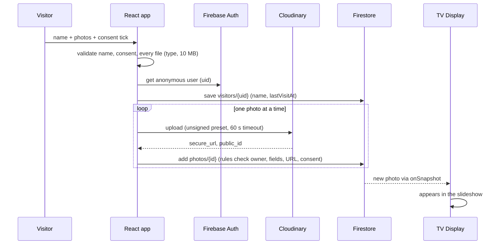
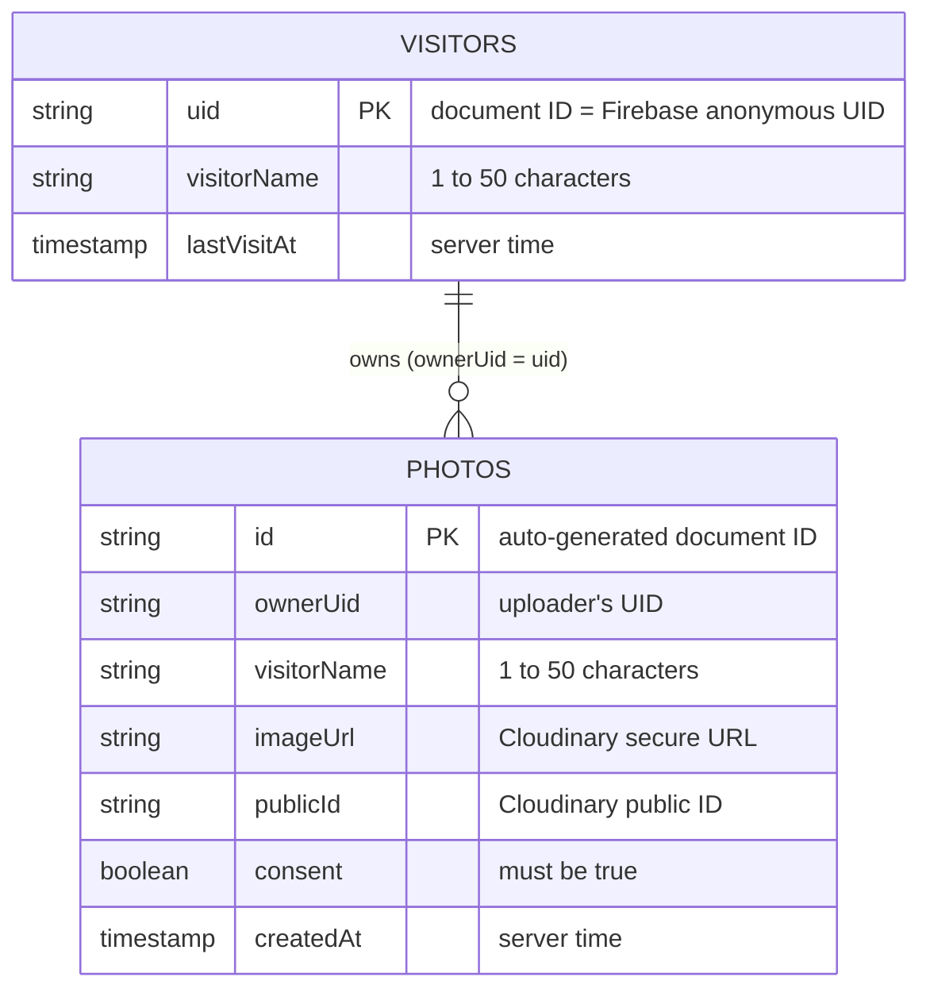

# ARCHITECTURE.md

## 1. Overview

Visitor Moments is a single-page React app. Visitors enter a name and upload photos. Images go to Cloudinary, and the photo records (URL, owner, consent, timestamp) go to Cloud Firestore. The TV Display is a full-screen slideshow in the same app that listens to Firestore in real time, so a new upload appears without a refresh.

There is no custom backend server. Security comes from Firebase Anonymous Auth, Firestore security rules (`firestore.rules`) and the Cloudinary upload preset.

## 2. Diagram: components and data flow

## 3. Diagram: what happens on upload

## 4. Stack choice and reasons

| Choice | Why | Trade-off |
|---|---|---|
| React + Vite (JavaScript) | Fast setup and rebuilds; component structure suits the form, the slideshow and the "your photos" list | Single-page app, so there is no server to hold secrets |
| Firebase Anonymous Auth | Gives each browser a stable UID with no sign-up, and the UID can be trusted in Firestore rules | Identity is per browser (see `ASSUMPTIONS.md`) |
| Cloud Firestore | Real-time listeners drive the live slideshow; security rules enforce ownership and consent without a backend | Rules cannot rate-limit |
| Cloudinary (free tier, unsigned upload) | Image storage and delivery without a backend or a paid storage plan; the preset restricts formats and size and resizes images on upload | Unsigned presets are usable by anyone who knows the cloud name and preset, and files cannot be deleted from the client |
| Vitest + React Testing Library | Same toolchain as Vite; used for the `validatePhoto` unit tests | Most behaviour was tested manually (see `ASSUMPTIONS.md`) |
| Vercel (planned) | Simple static hosting for a Vite app with environment variables | Deployed link to be added to `README.md` |

## 5. Data model (Cloud Firestore)

- **Returning visitor:** the same browser gets the same anonymous UID, so `visitors/{uid}` and the photos with `ownerUid == uid` are found again. The slideshow plays every consented photo, so a returning visitor's earlier photos play again together with the new ones.
- **Indexes:** the slideshow query (`consent == true`, ordered by `createdAt` ascending) needs a composite index on `photos`, which is created and enabled. The "your photos" query filters only on `ownerUid`, so it needs no composite index.
- **Images are not stored in Firestore**, only their URLs.

## 6. Security design

- **Firestore rules** (`firestore.rules`):
  - `visitors/{uid}`: only the signed-in owner can read, create or update it, with an allow-list of fields and a name length limit; it cannot be deleted.
  - `photos`: a signed-in user can read a photo only if it has consent, or if they own it. Creating a photo requires being the owner, an allow-list of fields, a name of 1 to 50 characters, `consent == true`, `createdAt` equal to the server time, and an `imageUrl` that starts with this account's Cloudinary address. Photos can never be updated. Only the owner can delete one.
- **Cloudinary preset** (`visitor_moments_unsigned`): allowed formats `jpg, jpeg, png, webp`; overwrite off; fixed asset folder `visitor-moments`; incoming transformation `c_limit,w_1920,h_1080`; account limits of 10 MB and 25 MP per image.
- **Client checks** (type, 10 MB, 10 photos, name length, consent) improve the user experience, but anyone can call Cloudinary or Firestore directly. The Cloudinary preset and account enforce the upload restrictions (formats, size, dimensions), and the Firestore rules enforce the database restrictions (ownership, fields, name length, consent). The 10-photos-per-submission limit is client-side only.
- **Secrets:** configuration is read from `VITE_*` environment variables. `.env.local` is git-ignored and `.env.example` has placeholders only. Firebase web config values are not secret by themselves; the rules control access.

## 7. Reliability

- Files are validated before any database write or upload, so an invalid file stops the whole batch.
- Photos upload one at a time. Separate visitors write separate documents, so they do not conflict.
- The Cloudinary upload stops after 60 seconds and Firestore writes stop waiting after 15 seconds. Both show an error and the form recovers so the visitor can retry.

## 8. Code structure

| File | Role |
|---|---|
| `src/App.jsx` | Upload form, consent, validation messages, opens the TV Display |
| `src/pages/Slideshow.jsx` | Real-time full-screen slideshow with pause, next, previous and exit |
| `src/components/MyPhotos.jsx` | A visitor's own photos with a delete button |
| `src/utils/cloudinary.js` | `validatePhoto` and the Cloudinary upload (progress, timeout, error messages) |
| `src/utils/visitorService.js` | Registers the visitor, validates the batch, uploads, saves photo records |
| `src/utils/cloudinary.test.js` | Unit tests for `validatePhoto` |
| `src/firebase/firebase.js` | Firebase setup and anonymous sign-in |
| `firestore.rules` | Firestore security rules |

## 9. Known limitations

See `ASSUMPTIONS.md` for the full list. The main ones: identity is per browser; deleting a photo does not delete the Cloudinary file; unsigned uploads and anonymous accounts can be abused to use up free quotas; there is no moderation; and no load testing was done.
